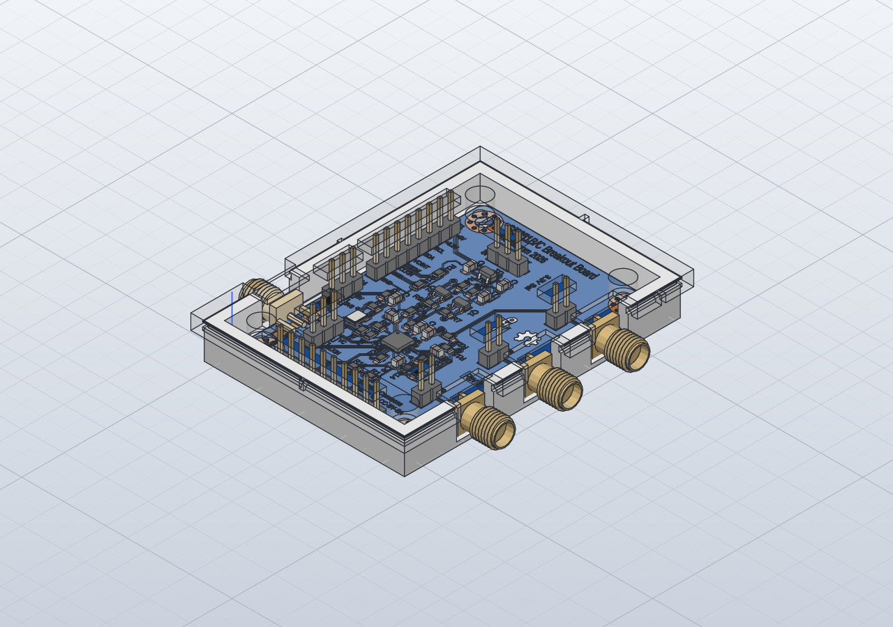

# Enclosure

Two-piece, snap-together case for the Si5351BC Breakout Board (42 × 60 × 1.6 mm).
Parametric design in SolidCraft, printed in white PETG on an Elegoo Centauri Carbon 2.

## Files

| File | What |
|------|------|
| `si5351bc_case_v4.sc` | Parametric design (SolidCraft). Every dimension is a named parameter — open in SolidCraft, edit, re-export. |
| `base_v4.stl` | Base: pocket, shelf, walls, four SMA bays, lid groove. Print as-is. |
| `lid_v4_print.stl` | Lid: plate, four-side snap skirt, SMA notches with barrel pockets, pin-header windows. Print as-is (plate face down). |
| `board_in_case_iso_v4.png` | Isometric render of the board in the case (lid at 22 % opacity). |

## Design

The board sits on a 2.8 mm shelf ledge with 0.4 mm clearance per side; 4.4 mm of
air to the base top, 8.0 mm with the lid on.

- **SMA pass-throughs** — four edge-launch SMAs: three on the +X wall at
  Y = −16.0 / 0.0 / 16.0 and one on the −X wall at Y = −17.0 (board-centre
  origin). Each bay is a single opening from a 1.0 mm bay floor up past the wall
  top: 8.8 mm wide (7.2 mm flange + 0.8 mm solder margin per side). The lid
  plate carries a 1.0 mm-deep, 10.0 mm-wide pocket over every barrel so it
  clears the 6.35 mm barrel tops, with 1.2 mm of lateral clearance in each
  notch.
- **Lid** — snaps on over a 2.0 mm skirt: 0.6 mm ribs riding in 0.5 mm grooves
  (0.2 mm clearance) on all four walls; on the two SMA walls the rib splits
  into ridges passing between the notches (four on +X, two on −X). The plate
  carries ⌀2.5 bosses over the four mounting holes at (±17, ±26), clamping the
  board when closed.
- **Headspace** — pin headers pass through lid windows, 4.4 mm above the board.

| Part | Size (mm) |
|------|-----------|
| Base | 47.60 × 65.60 × 8.40 |
| Lid | 50.80 × 68.80 × 6.90 (5.30 mm engaged) |

### Revision history

| Rev | Change |
|-----|--------|
| v2 | First working case (base + lid), four-side snap from the start. |
| v3 | Lid only: SMA notches widened by a 1.2 mm clearance band and a 1.0 mm-deep barrel pocket added to the plate over all four connectors. Base unchanged (18/18 features identical). |
| v4 | Base only: SMA bays and shelf reliefs deepened from the 1.6–1.7 mm pocket floor to the 1.0 mm bay floor. A 2.6–2.7 mm ledge under each flange was wedging the board up and stopping the lid from seating; the bays now open floor-to-top and the board sits flat. Lid unchanged (v4 ≡ v3). |

## Printing

Elegoo Slicer · white Rapid PETG (tray 0) · 0.2 mm layers · 3 walls · 15 %
infill · no brim · 250 °C / 70 °C bed (textured PEI) · no supports.

| Part | Layers | Filament | Est. time |
|------|--------|----------|-----------|
| Base v4 | 42 | 10.24 g | 28 min 15 s |
| Lid v4 (plate down) | 35 | 7.75 g | 31 min 33 s |

Both STLs verified watertight before slicing. Post-print check: first layer
flat, no warp or delamination.

## Tools

- **Board geometry** — parsed directly from `pcb/Si5351BCBreakout.kicad_pcb`
  (KiCad 10): outline, SMA row centres, mounting-hole positions. No eyeballing.
- **CAD** — [SolidCraft](https://solidcraft.io) 0.42: parametric `.sc` design
  (parameters: `BL`/`BW`, `CLR`, `SMAW`, `SMA_MARGIN`, `SY1..3`, `SYL`,
  `HX1/2`, `HY1/2`, `BOSS_D`, …), board import via `doc.open`, isometric render.
- **Verification** — watertight-mesh checks on every export, point-in-solid
  raycasts through each bay, and per-feature diffs of the `.sc` between
  revisions so only changed parts get reprinted.
- **Printing** — Elegoo Centauri Carbon 2; preflight (machine status, tray
  check, bed photo) and progress monitoring via pycentauri.

To adapt for a board revision: change `BL`/`BW`/`SY*`/`HX*`/`HY*` in the `.sc`
and re-export both parts.
